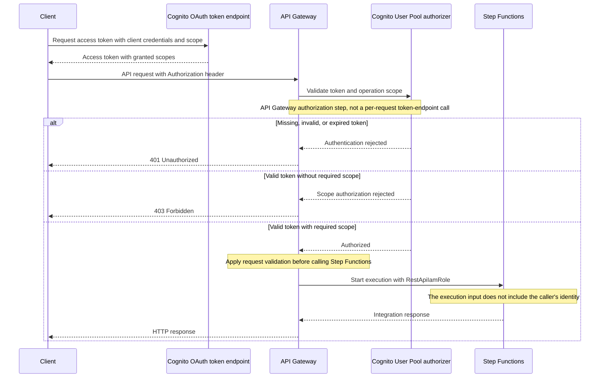
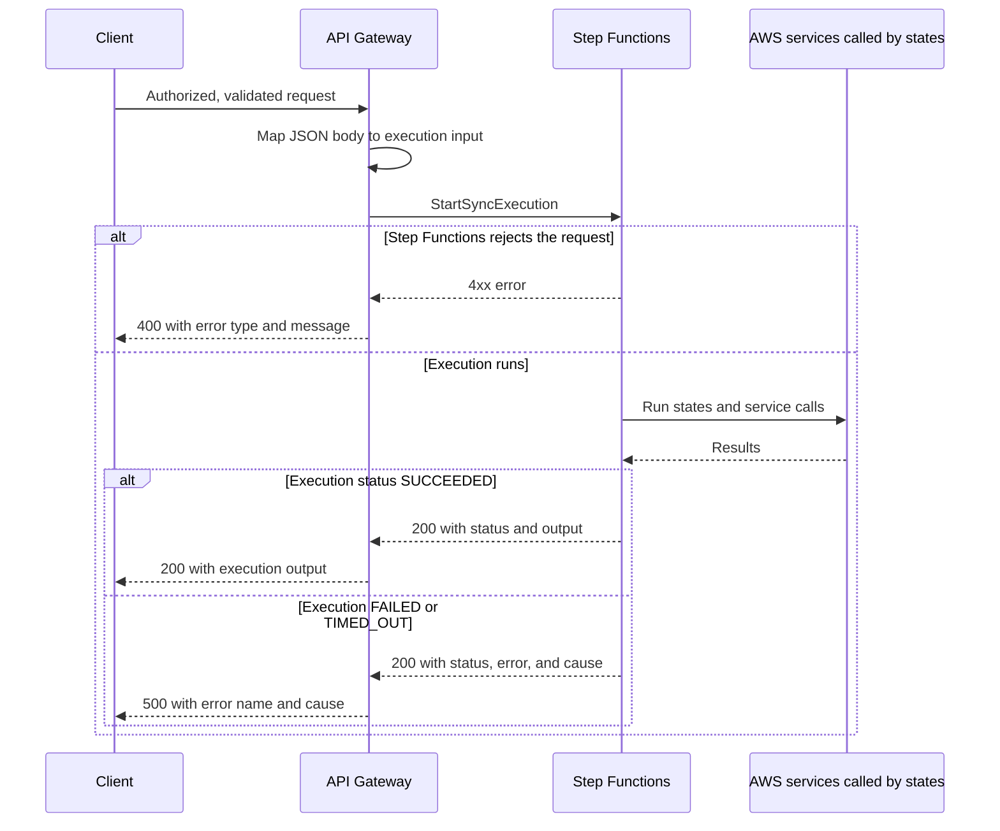
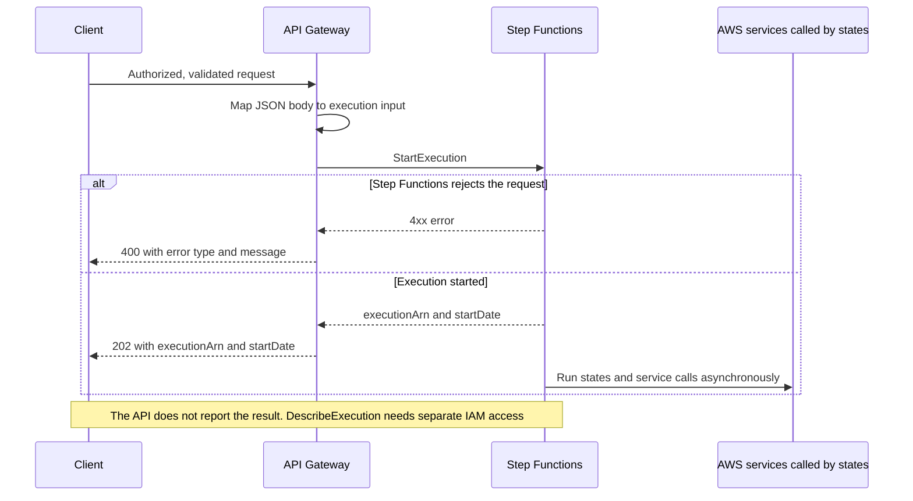


# Architecture

## Infrastructure

### Logical architecture

The service separates the API boundary, what starts an execution, the
workflow, and the work each step does:



- The API contract defines the endpoint that starts the workflow, its input
  and output shapes, and required authentication scopes.
- Authentication and scope authorization guard the API boundary. Any
  ownership or tenant checks belong in the workflow.
- The API boundary starts executions directly; there is no function between
  the API and the workflow.


- A trigger, or an operator or service calling the Step Functions API, starts
  executions with a JSON input.

- The workflow, defined in Amazon States Language, decides the order of steps,
  passes data between them, and handles retries and errors.
- Each step either transforms data itself or calls an AWS service, and needs
  permission for every service it calls.
- Logs, metrics, and traces expose execution behavior for operations.


The health endpoint checks the API boundary through a mock response; it does
not check the workflow.


#### Logical architecture diagram

```mermaid
flowchart LR

    Consumer["API consumer"]
    Boundary["API boundary: authentication, scopes, request validation"]
    Contract["API contract"]
    Health["Health mock"]

    Trigger["Trigger, operator, or other service"]

    Workflow["Workflow: ordered steps, data flow, retries, and error handling"]
    Steps["Steps: data transformation and AWS service calls"]
    Observability["Logs, metrics, and traces"]



    Consumer --> Boundary
    Contract -.->|"Defines route and constraints"| Boundary
    Boundary -->|"Accepted request starts execution"| Workflow
    Boundary -->|"Accepted health request"| Health
    Boundary --> Observability


    Trigger -->|"Starts execution with JSON input"| Workflow

    Workflow --> Steps
    Workflow --> Observability
```


#### Authentication and authorization call sequence

This example uses an existing app client with the client-credentials flow
enabled. Interactive clients use their configured OAuth flow instead.
API Gateway validates access tokens using the configured Cognito authorizer;
it does not call the Cognito token endpoint for every API request.



The authorized `/health` route uses a mock integration rather than
Step Functions. The pool, OAuth app client, and resource-server scopes must
already exist.

#### Execution call sequence


The state machine is an Express workflow, so API Gateway calls
`StartSyncExecution` and waits for the result. The diagram assumes an
authorized request that passed validation.



`StartSyncExecution` returns HTTP `200` even when the execution fails; the
response template in `openapi.yaml` checks the execution `status` and overrides
the response status. The integration times out after 29 seconds by default,
regardless of how long the execution is allowed to run.


The state machine is a Standard workflow, so API Gateway calls
`StartExecution` and returns as soon as the execution starts. The diagram
assumes an authorized request that passed validation.





#### Execution start sequence

```mermaid
sequenceDiagram

    participant Starter as EventBridge Scheduler

    participant Producer as Event producer
    participant Bus as Default event bus
    participant Starter as EventBridge rule

    participant Starter as Operator or service

    participant SFN as Step Functions
    participant Services as AWS services called by states


    Note over Starter: Schedule expression ${{ values.schedule_expression }}
    Starter->>SFN: StartExecution using the SAM-generated scheduler role

    Producer->>Bus: PutEvents
    Bus->>Starter: Match source and detail-type
    Starter->>SFN: StartExecution with the event as input, using the SAM-generated rule role

    Starter->>SFN: StartExecution with its own IAM permissions and JSON input

    SFN->>Services: Run states and service calls
    Services-->>SFN: Results
    Note over SFN: Execution succeeds or fails. The caller is not notified
```


The trigger does not wait for the execution or retry a workflow that fails.
Handle failures inside the workflow, and watch failed-execution metrics; see
[Observability](06-observability.md).



### Physical architecture

```mermaid
flowchart TD

    Zone["Route 53 hosted zone (existing)"]
    Record["Route 53 alias record"]
    Certificate["ACM certificate"]
    Domain["API Gateway regional custom domain"]
    Api["Regional API Gateway REST API"]
    Cognito["Cognito User Pool (existing)"]
    ApiRole["RestApiIamRole"]
    ApiLogs["API Gateway access log group"]

    Trigger["EventBridge Scheduler schedule"]
    TriggerRole["SAM-generated scheduler role"]

    Bus["Default event bus (existing)"]
    Trigger["EventBridge rule"]
    TriggerRole["SAM-generated rule role"]

    Trigger["Operator or service (external)"]

    StateMachine["${{ values.state_machine_name }} state machine (${{ values.state_machine_type }})"]
    Role["SAM-generated state machine role"]
    Ssm["SSM parameters: ARN and name"]

    Logs["Execution log group"]


    XRay["AWS X-Ray"]

    CloudWatch["CloudWatch metrics"]



    Zone --- Record
    Record -->|"Alias target"| Domain
    Certificate -->|"TLS certificate"| Domain
    Domain -->|"Base path mapping"| Api
    Api -.->|"Authorizer configured with pool ARN"| Cognito
    Api -->|"Assumes"| ApiRole
    ApiRole -->|"${{ 'StartSyncExecution' if is_sync else 'StartExecution' }}"| StateMachine
    Api --> ApiLogs
    Api --> CloudWatch


    Bus --> Trigger
    Trigger -->|"Assumes"| TriggerRole
    TriggerRole -->|"StartExecution"| StateMachine


    Trigger -->|"Assumes"| TriggerRole
    TriggerRole -->|"StartExecution"| StateMachine


    Trigger -.->|"StartExecution"| StateMachine

    StateMachine -->|"Runs as"| Role
    Ssm -.->|"Stores identifiers of"| StateMachine

    StateMachine --> Logs


    StateMachine --> XRay

    StateMachine --> CloudWatch
```

`template.yaml` declares:

- The state machine and its SSM parameters.

- The execution log group.


- The API, certificate, DNS configuration, API access log group, and
  `RestApiIamRole`.


SAM generates the state machine's execution role, the
schedulerule, and the role that starts executions.
 The Cognito pool, hosted zone, SSM hosted-zone
parameter, API Gateway account logging role, and CI roles are external
dependencies.
 The default event bus, the
services that put events on it, and the CI roles are external dependencies.
 The CI roles are external dependencies.



The API stage is named by `CodeBranch`. Its access log group is
`/aws/api-gateway/<stack-name>` with seven-day retention.
 Detailed logging and metrics are described in
[Observability](06-observability.md).

### CloudFormation template

`template.yaml` is the infrastructure-as-code entry point. Its
`Transform: AWS::Serverless-2016-10-31` enables AWS SAM resources, which
CloudFormation expands into the AWS resources needed to deploy the service.

| Section | Purpose |
| --- | --- |
| `Parameters` | Supplies domain/system/component metadata and the branch name, plus hostname, hosted-zone SSM parameter, and existing Cognito pool ARN, plus execution log retention. |
| `Resources` | Declares the state machine, execution log group, certificate, API, API access log group, `RestApiIamRole`, and SSM parameters. SAM also generates supporting resources such as the state machine's execution role and the schedule and its role and the rule and its role. |
| `Outputs` | Publishes the state machine ARN and name and the endpoint URL. |


The API's `DefinitionBody` includes `openapi.yaml` through `AWS::Include`.
That file defines routes, Cognito authorization, and the Step Functions
integration, which references the state machine and `RestApiIamRole`.


`Ref`, `GetAtt`, and `Sub` connect resources without hard-coding generated
names or ARNs.

#### Template resource relationships

Arrows below run from the referencing resource/configuration to its target;
they show infrastructure references, not request flow.

```mermaid
flowchart TD
    Params["Domain, System, Component, CodeBranch parameters"]
    StateMachine["${{ values.state_machine_name }}StateMachine: SAM state machine"]
    Definition["statemachine/${{ values.state_machine_name }}.asl.yaml: definition"]
    SsmParams["${{ values.state_machine_name }}StateMachineArnSsmParam and NameSsmParam: SSM parameters"]
    ExecutionRole["SAM-generated execution role"]

    Retention["StateMachineLogRetentionInDays parameter"]
    LogGroup["${{ values.state_machine_name }}StateMachineLogGroup: CloudWatch log group"]


    TriggerResources["SAM-generated schedulerule and role"]


    Hostname["Hostname parameter"]
    ZoneId["DnsZoneId parameter: resolves existing SSM hosted-zone value"]
    PoolArn["CognitoUserPoolArn parameter"]
    Certificate["SiteCertificate: ACM certificate"]
    Api["RestApi: SAM API"]
    ApiLogs["RestApiLogGroup: CloudWatch log group"]
    ApiRole["RestApiIamRole: IAM role"]
    OpenApi["openapi.yaml: included API definition"]
    Generated["SAM-generated domain, base path mapping, and Route 53 record"]


    StateMachine -->|"DefinitionUri"| Definition
    StateMachine -->|"DefinitionSubstitutions"| Params
    StateMachine -->|"Policies"| ExecutionRole
    SsmParams -->|"Ref and GetAtt Name"| StateMachine
    SsmParams -->|"Parameter name path"| Params

    StateMachine -->|"Logging destination"| LogGroup
    LogGroup -->|"RetentionInDays"| Retention


    StateMachine -.->|"SAM expands Events"| TriggerResources


    Certificate -->|"DomainName"| Hostname
    Certificate -->|"DNS validation HostedZoneId"| ZoneId
    Api -->|"DomainName"| Hostname
    Api -->|"CertificateArn"| Certificate
    Api -->|"Route53 HostedZoneId"| ZoneId
    Api -->|"StageName"| Params
    Api -->|"AccessLogSetting DestinationArn"| ApiLogs
    Api -->|"AWS Include DefinitionBody"| OpenApi
    OpenApi -->|"Integration credentials"| ApiRole
    OpenApi -->|"Request template stateMachineArn"| StateMachine
    OpenApi -->|"Authorizer providerARNs"| PoolArn
    ApiRole -->|"Policy allows ${{ 'states:StartSyncExecution' if is_sync else 'states:StartExecution' }}"| StateMachine
    Api -.->|"SAM expands Domain configuration"| Generated

```


`RestApiIamRole` trusts `apigateway.amazonaws.com` and is the integration's
credentials. It is not the account-level API Gateway CloudWatch logging role.


`cfn-parameters.json` and `cfn-tags.json` provide deployment-action inputs,
while `samconfig.toml` supplies SAM deployment defaults. See
[Configuration](03-configuration.md) for their expression syntax and external
prerequisites. Validate changes with `sam validate --lint` and prepare the
deployment artifact with `sam build` before deployment.

## Software

### Repository file layout

```text
catalog-info.yaml       Backstage Component and API entities entity
mkdocs.yml              TechDocs site configuration
docs/handbook/          Handbook pages
README.md               Project entry point
template.yaml           SAM infrastructure

openapi.yaml            API contract and Gateway integrations

statemachine/           State machine definition in ASL
cfn-parameters.json     Deployment-action parameter expressions
cfn-tags.json           Deployment-action tag expressions
samconfig.toml          SAM deploy defaults
.github/workflows/      main.yml and branch.yml
LICENSE                 Project license
.gitignore              Ignored local files
```

If Spec Kit was initialized during creation, its files are also present.
These are generated-project paths. The template source repository keeps their
inputs separately under `skeleton/base/`, `skeleton/apievent/`,
and `pipeline/` before the scaffolder combines them.

### Anatomy of the state machine definition

`statemachine/${{ values.state_machine_name }}.asl.yaml` is a YAML ASL document:

| Field | Purpose |
| --- | --- |
| `Comment` | Human-readable description shown in the console. |
| `QueryLanguage` | `JSONata` for every state unless a state overrides it. |
| `StartAt` | Name of the first state, `ProcessInput` in the starter. |
| `States` | Map of state names to definitions. Every path must end in a `Succeed`, `Fail`, or a state with `End: true`. |

With JSONata, a string that starts with `{%` and ends with `%}` is an
expression. The most common pieces are:

| Construct | Meaning |
| --- | --- |
| `$states.input` | The state's input. |
| `$states.result` | A Task's result, available in `Output` and `Assign`. |
| `$states.errorOutput` | The error in a `Catch` block. |
| `$states.context` | The [context object](https://docs.aws.amazon.com/step-functions/latest/dg/input-output-contextobject.html), such as the execution ID and start time. |
| `Arguments` | The input sent to a Task's service integration. |
| `Output` | The state's output; defaults to the state's result or input. |
| `Assign` | Workflow variables that later states read as `$name`. |

For example, a Task state that writes an item and keeps its input as output:

```yaml
SaveOrder:
  Type: Task
  Resource: arn:aws:states:::dynamodb:putItem
  Arguments:
    TableName: ${OrdersTableName}
    Item:
      pk:
        S: ''
  Output: ''
  Next: Done
```

`${OrdersTableName}` is not JSONata: it is a definition substitution that SAM
replaces before the definition is deployed. The starter substitutes
`${Domain}`, `${System}`, `${Component}`, and `${CodeBranch}`; add others under
`DefinitionSubstitutions` in `template.yaml`.

### IAM roles

| Role | Created by | Grants |
| --- | --- | --- |
| State machine execution role | SAM, from the state machine's `Policies` | Log delivery and X-Ray writesNothing yet. Add a policy for each service a state calls. |

| Scheduler role | SAM, from the `ScheduleV2` event | `states:StartExecution` on this state machine. |

| Rule role | SAM, from the `EventBridgeRule` event | `states:StartExecution` on this state machine. |


| `RestApiIamRole` | `template.yaml` | `${{ 'states:StartSyncExecution' if is_sync else 'states:StartExecution' }}` on this state machine. |


Prefer [SAM policy templates](https://docs.aws.amazon.com/serverless-application-model/latest/developerguide/serverless-policy-templates.html)
scoped to specific resources over broad managed policies.
